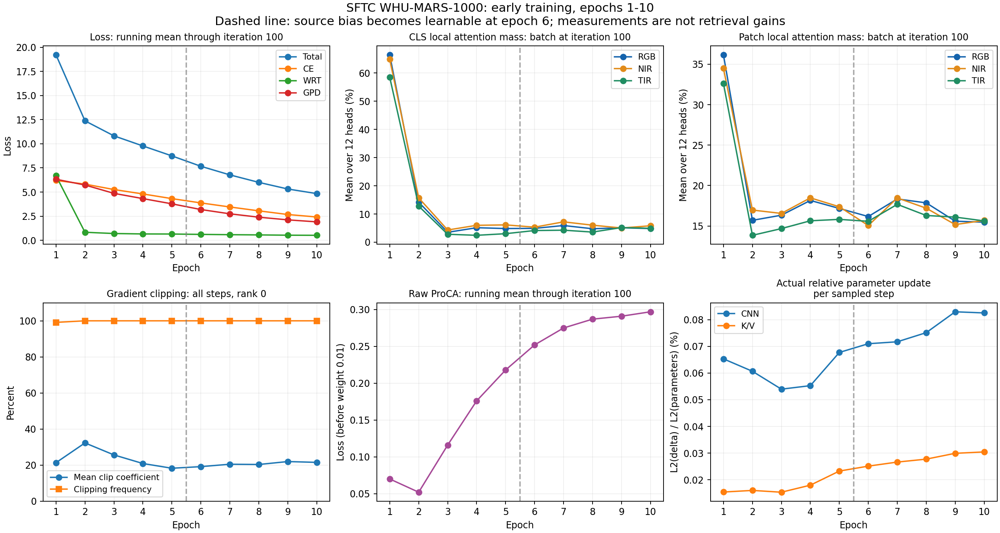

# SFTC_1000_DDP：Epoch 1–10 数值核对与趋势诊断

分析日期：2026-10-14（Asia/Shanghai）。结论：当前记录支持训练机制按设计运行、新分支持续获得梯度和参数更新，尚不能判定检索增益。需要继续关注原始ProCA上升、持续全局裁剪以及AMP溢出是否重复出现。当前上传日志的Epoch10评测尾部不完整。

## 数据范围与统计口径

输入为`WHU/SFTC_1000_DDP/`下的训练日志、`sftc_diagnostics.jsonl`和三个Rank的CLS诊断。共30个训练诊断点（每Epoch的Iteration1、50、100）、10个全Epoch裁剪汇总、20组损失打印、三组各8张图像的Epoch10 CLS诊断。没有提供baseline同阶段日志或checkpoint。

下面的损失/Acc为各Epoch打印在Iteration100处的累计均值，不是完整Epoch平均值。注意力为该次Iteration100单批的12个Head均值，不是Epoch/全数据集均值。更新均值只来自稀疏诊断Step，排除初始AMP跳步；全Epoch裁剪汇总则覆盖Rank0全部114或115个Step。

逐项计算数据见[summary.json](summary.json)。原始Infinity在该严格JSON报告中表示为null，同时保留`nonfinite_sampled`记录。重现计算和绘图脚本位于工作区`tmp/analyze_sftc_run.py`。没有改动训练/模型/评测代码，也没有改写用户上传的日志。

## 1. 配置、结构、损失加权及学习率：一致

日志使用`configs/SFTC.yml`，本地文件名为`configs/UAD_SFTC_V2_1.yml`；日志展开的结构和训练参数与本地冻结配置吻合。无需因文件改名判断实验不同。

- 4进程、基础全局batch256、每Rank基础batch64，三模态展开为192张，K=4，因此每Rank16个身份，每身份每模态4张。实际记录Attention形状均为`[192,12,129,257]`。
- RGB/IR/Thermal映射为RGB/NIR/TIR参数行0/1/2；Block index6；120 Epoch；SGD；基础LR0.032；新增LR倍数3；clip1.0；ProCA权重0.01、GPD新中心更新系数0.2；pre-BN、L2、无reranking、TOP_K=0。
- 所有记录的来源概率有限且位于[0,1]，每模态每类Query均12个Head。
- 20组打印满足`Total=CE+WRT+0.01*ProCA+GPD`，最大重构误差0.001，可由日志三位小数舍入解释。
- 新增26个参数组在每个诊断点的实际LR完全一致，并逐Epoch与当前warm-up/cosine公式吻合，最大数值误差0。基础LR的打印为有效数字舍入。

| Epoch | 基础weight LR（公式） | 新增参数实际LR |
|---:|---:|---:|
| 1 | 0.006656 | 0.019456 |
| 2 | 0.013056 | 0.038592 |
| 3 | 0.019456 | 0.057728 |
| 4 | 0.025856 | 0.076864 |
| 5 | 约0.031863 | 0.095590 |
| 6 | 约0.031803 | 0.095409 |
| 10 | 约0.031456 | 0.094366 |

Epoch5已进入原cosine分支，因此略低于0.032/0.096峰值；warm-up初始值为原统一数值，因此Epoch1–4并非每步精确3倍。这符合原scheduler，没有发现调度错误。

## 2. 身份损失下降明确，但ProCA没有同步改善

| Epoch | Total | CE | WRT | 原始ProCA | GPD | 训练Acc |
|---:|---:|---:|---:|---:|---:|---:|
| 1 | 19.219 | 6.200 | 6.692 | 0.070 | 6.326 | 0.9% |
| 2 | 12.381 | 5.822 | 0.831 | 0.052 | 5.728 | 2.2% |
| 3 | 10.825 | 5.260 | 0.700 | 0.116 | 4.864 | 5.3% |
| 5 | 8.748 | 4.318 | 0.649 | 0.218 | 3.779 | 17.1% |
| 6 | 7.671 | 3.873 | 0.609 | 0.252 | 3.187 | 23.4% |
| 10 | 4.839 | 2.413 | 0.515 | 0.297 | 1.909 | 50.4% |

CE/GPD下降和Acc上升支持训练身份判别在改善。WRT从早期较高值迅速下降，此后缓慢下降；其本身没有固定必须接近零的门槛。不能仅凭WRT变小排除特征退化，但这里CE/Acc/GPD共同改善，没有单独依据认定发生完全塌缩。

原始ProCA从Epoch2的0.052升至Epoch10的0.297，说明在该日志累计统计口径下，模态中心到身份锚点的平方距离在增加。应把它视作需要继续观察的跨模态对齐信号，不能把四项损失都描述为收敛良好。

可能的解释是早期特征不够分化，模态中心距离也较小；身份判别增强后，不同模态的偏移被暴露。此解释是推断，当前记录不足以确认特征是否曾塌缩，亦不能证明对齐权重不合适。ProCA定义下0.297仍在正常数值范围内，并非越界/NaN。

Epoch10加权ProCA仅0.00297，约占Total的0.0614%；数值贡献小不等同梯度贡献小，当前未按损失分别记录梯度，不能据此断言没有监督作用。先保持原0.01权重，用后续趋势、跨模态检索和同阶段UAD对照判断。

## 3. 来源偏置固定/释放正确；来源概率降低主要不是偏置所致

前5个Epoch的15个采样点，36个来源偏置全部精确为−2。Epoch6开始`bias_fixed=False`，Iteration100偏置范围为[−2.007411,−1.992779]；Epoch10范围[−2.022460,−1.983938]。说明释放后参数开始更新，没有被冻结死，也没有出现偏置数值大幅漂移。

| Epoch，Iteration100 | CLS局部概率 RGB/NIR/TIR | Patch局部概率 RGB/NIR/TIR |
|---:|---:|---:|
| 1 | 66.44% / 64.88% / 58.50% | 36.15% / 34.49% / 32.62% |
| 2 | 14.21% / 15.71% / 12.80% | 15.70% / 16.97% / 13.85% |
| 3 | 3.50% / 4.32% / 2.81% | 16.34% / 16.56% / 14.68% |
| 5 | 4.84% / 6.14% / 3.01% | 17.17% / 17.38% / 15.82% |
| 6 | 4.90% / 5.33% / 4.13% | 16.17% / 15.06% / 15.58% |
| 10 | 4.84% / 5.82% / 4.92% | 15.47% / 15.69% / 15.63% |

第一步CLS概率均值约13.97%/16.30%/18.65%；Epoch1中期升到约70.15%/65.84%/62.69%，随后在Epoch2–3下降。不能将第一Epoch末的高值当作初始化固定来源比例。

最明显的下降发生在偏置仍固定的阶段，因此主要涉及Q/K内容匹配、CNN/ViT表征及其相对分布的变化。Epoch10偏置偏移最大约0.022，对`exp(b)`的相对变化约几个百分点，解释不了CLS来源份额从60%以上降至5%左右的数量级变化。

从Epoch3以后看，概率围绕较低范围波动，没有持续逼近零的明显趋势；Patch保持约15%–18%。不能认定“局部分支被关闭”，同时也不能据概率认定CNN提供身份增量。联合softmax仍会替换部分主干响应。

注意力概率已经在Dropout前统计。发现一处统计精度细节：`record_attention`虽显式将输入转float32，但处于外层autocast内，`membership @ mass`仍可能被转换为低精度matmul。已用本机CPU BF16复现该dtype行为；CUDA日志数值也呈FP16量化特征。这是统计精度问题，不参与loss、不改变训练，不影响本次数量级判断。若后续调整记录代码，可仅在这段统计中关闭autocast；不能将旧记录当作完整FP32精确测量。

## 4. 新分支有真实更新；裁剪明显，首步AMP溢出已跳过

29个有限梯度诊断点中，CNN裁剪前梯度范数范围约[0.458,13.359]、KV约[0.209,5.298]，全模型约[2.061,29.498]，CNN/KV均有非零实际参数更新。

Epoch10三个采样Step的平均相对更新范数：CNN约0.08254%/step，KV约0.03043%/step。Iteration100的绝对更新L2分别0.042255/0.023444，相对更新0.08536%/0.03027%。这些值排除了新增参数未入optimizer、断图或长期不更新的情况；不能证明学到有效身份细节。更新包括SGD动量和适用参数的Weight Decay，不等于`LR×当前梯度`。

| Epoch | 全Epoch裁剪触发率 | 平均裁剪系数 |
|---:|---:|---:|
| 1 | 99.12% | 0.2136 |
| 2 | 100% | 0.3232 |
| 5 | 100% | 0.1829 |
| 6 | 100% | 0.1918 |
| 10 | 100% | 0.2154 |

全10个Epoch共1141个Step的Rank0裁剪汇总，Epoch4为115步，其余114步。原PKM样本组耗尽与随机尾部会使Epoch长度略变，现有日志不能据此判定batch缩小或DDP分配错误。所有记录的真实Attention batch都为192。

几乎每步裁剪、典型平均系数约0.18–0.32，表示梯度被明显共同缩放，值得监控。这个系数是Step的平均，不是平均梯度范数的倒数，也不能与LR相乘后当作真实参数更新；动量会影响实际步长。当前CNN/KV实际更新没有趋零，不建议凭这一项就删除或放宽原UAD的clip1.0。

唯一已记录的非有限梯度点为Epoch1 Iteration1：CNN范数inf、全局inf、KV有限、clip系数0；`amp_step_skipped=true`，CNN/KV实际更新均为0。这是一次被GradScaler保护性跳过的溢出，符合[PyTorch AMP文档](https://docs.pytorch.org/docs/2.14/notes/amp_examples.html)。后29个采样点有限，没有发现持续梯度爆炸证据，但不能据稀疏采样声称全部1141步只有一次溢出，也不能确定具体溢出的参数/算子。

原因可能与初始loss scale和新增CNN的较大梯度有关；当前日志没有scale和逐参数非有限位置，不能将原因归结为某一层。原实现会在AMP跳步后仍更新原型库，这是继承UAD的行为，不是本次日志证明的新增缺陷；单次事件不足以改变原更新协议。

## 5. 最终CLS开关差异明显，弱模态效果仍需检索验证

| Epoch10，每模态8张图像 | 开关CLS余弦距离均值 | 相对L2差异均值 |
|---|---:|---:|
| RGB | 0.052195 | 32.37% |
| NIR | 0.047782 | 30.55% |
| TIR | 0.080472 | 39.92% |

这支持局部来源确实影响最终检索向量，其影响没有完全消失。CLS直接读取约5%不代表最终影响必然微小：局部来源也进入Patch，之后经过剩余ViT层传播。这是合理路径解释，不是对单独Patch路径贡献的测量。

TIR差异最大，但只能表述为这些TIR样本对关闭来源更敏感，不能表述为TIR检索改善最大。每模态只有第一验证批前8张，不是随机大样本或全集结果；没有来源关闭后的检索指标，亦没有独立UAD对照。

Rank0/1/2分别有RGB/NIR/TIR文件正确。4卡只分配三个模态验证，Rank3空闲，因此没有Rank3 CLS文件是预期行为。

## 6. 当前评测记录不足以判断优劣

上传日志最后一条为2026-10-14 00:00:33.013的RGB→TIR结果，只含：

| Epoch10协议 | Rank1 | mAP | mINP |
|---|---:|---:|---:|
| RGB→RGB | 20.94% | 12.96% | 2.20% |
| RGB→NIR | 10.30% | 6.43% | 0.95% |
| RGB→TIR | 2.72% | 2.28% | 0.54% |

跨TIR显著更难，但这是单次早期验证。没有NIR/TIR作为Query的六组结果、AG结果或整体AS-ReID汇总，也没有同阶段baseline；不能判定提升、下降或准确率是否“应当更高”。不能把前三组mAP平均当作完整Gallery AS-ReID mAP。

日志出现Query/Gallery modalities=[1,2,3]，支持三个模态的特征已汇集到评测。记录没有最终`Validation Results - Epoch: 10`，不能确认整个评测已完成；可能上传的是部分日志，文件本身不能确认服务器进程是否仍在运行或停滞。

## 下一次检查

保留当前结构、LR、clip1.0和四项损失，让冻结实验继续；当前数值没有提供必须重启或改训练超参数的理由。优先补齐Epoch10完整评测尾部，再提供Epoch20/30相同诊断文件。重点看：ProCA是否继续上升；CLS/Patch局部份额与CNN/KV实际更新是否持续趋零；是否重复AMP非有限；整体AS和所有跨TIR组合如何变化。

若后续要更精确地判断AMP稳定性，可增加每Epoch所有Step的跳步计数/scale日志，以及纯诊断段FP32统计。它们属于记录改进，当前分析未修改代码。正式方法效果仍需独立UAD同配置训练与120 Epoch完整检索比较。
