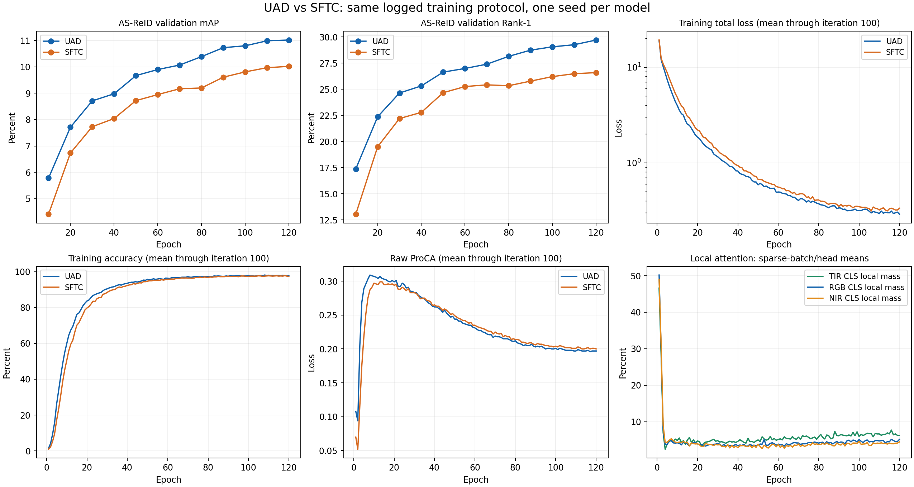
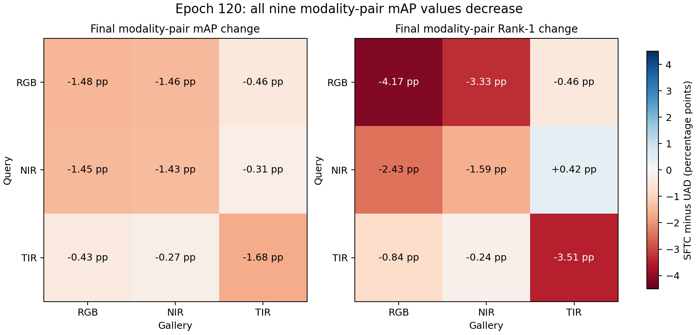
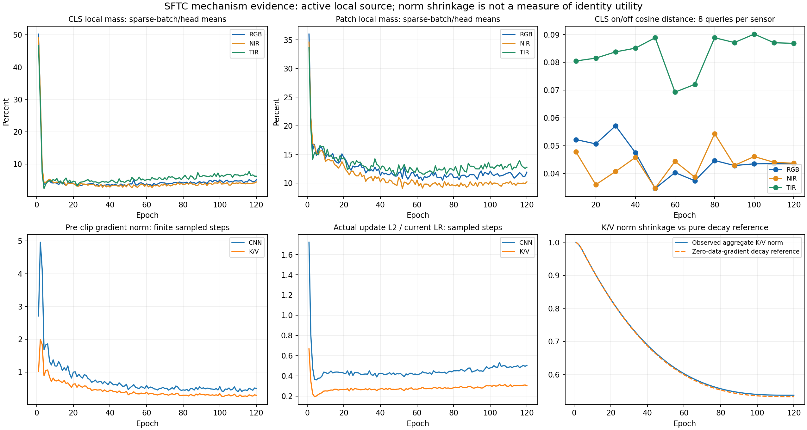

# SFTC-V2.1 完整 120 Epoch 与 UAD 对照分析

分析日期：2026-10-14。分析范围：用户上传的完整训练、验证和诊断日志，以及当前本地方案、实现和参考论文。本文不修改模型、训练器、损失、配置或评测代码。

**结论：当前这次 SFTC-V2.1 实验没有达到方案目标，表现为贯穿训练过程的负增益。已有证据更支持“新增来源与原预训练主干的耦合、优化和身份信息质量不足”，而非模块未执行、未更新或单纯训练轮数不足。可以据此修正方案，但不能仅凭日志确定某一个因素是唯一原因。**

## 1. 证据范围与统计口径

输入文件位于 [SFTC_1000_DDP](../../SFTC_1000_DDP/)：

- `train_log_20261013_2331.txt`：SFTC 完整 120 Epoch。
- `UADtrain_log_20260911_2145.txt`：历史 UAD 完整 120 Epoch。
- `sftc_diagnostics.jsonl`：360 个训练采样点、120 个 Rank 0 全 Epoch 裁剪汇总。
- 三份 `sftc_cls_diagnostics_rank*.jsonl`：每模态 12 次验证，每次仅前 8 个 Query 的来源开关特征差异。

两份主日志各提取 120 组 Iteration 100 训练累计均值、12 次整体评估、12×9 个模态组合评估，以及 120 个 Epoch 耗时。原始数据和计算结果见 [summary.json](summary.json)，复算及绘图脚本见 [analyze_sftc_complete.py](../../../tmp/analyze_sftc_complete.py)。

重要口径：

- 本文训练损失和 Acc 是每个 Epoch 从开头累计到 Iteration 100 的 Rank 0 日志均值，不是最后一个 Batch，也不是完整 Epoch 的全 Rank 均值。
- 来源概率是每个 Epoch 的 Iteration 1/50/100、12 个 Head 的等权平均，属于稀疏训练采样。不要与此前仅取 Iteration 100 的早期报告逐值混用。
- 梯度与更新均值排除采样到的非有限梯度步骤；裁剪 Epoch 汇总覆盖 Rank 0 全 Epoch。
- 指标单位为百分比；差值单位为百分点（pp）。12 个评估时点及 108 个模态组合比较彼此相关，不能当作独立随机试验计算显著性。
- 未上传训练权重、实际数据或运行环境快照。本地只能解析日志、审查实现和计算机制参考，不能执行真实完整检索消融。

## 2. 对照是否公平、数值是否自洽

两次日志共同的训练与评测配置一致：4 个 DDP 进程，基础全局 Batch 256，每 Rank 基础 Batch 64、三模态实际 192 张图，K=4；ViT-B/16、256×128；SGD Momentum=0.9、BASE_LR=0.032、Weight Decay=1e-4；5 Epoch warm-up、120 Epoch cosine；种子 1234；原 CE/WRT/ProCA/GPD；同名 ImageNet 权重；pre-BN、原归一化及评测设置。

所有 120 个 Epoch 的采样器步数相同，总计各 13,704 步；所有 Epoch 打印的基础学习率相同。日志配置差异仅为 SFTC 部分、输出目录、显式 `GRAD_CLIP_NORM=1.0`（原实现硬编码该值）及新增详细域评估开关。没有发现悄悄减少 Batch、变更学习率或训练长度造成的明显对照问题。

240 组损失打印与 `CE + WRT + 0.01×ProCA + GPD` 的最大重构误差为 0.00136，处于四项分别保留三位小数的舍入误差范围。整体 AS-ReID mAP 不应等于九个模态子集 mAP 的算术平均：它们使用的 Gallery 候选、负例与 Query 权重不同，排序任务也不同。

这些检查支持日志内部一致；不等同于证明两次运行的数据内容、权重哈希、代码版本、硬件和软件完全相同。两次训练相隔一个月，且每个模型只有一个种子。相同种子也不保证增加模块后仍有逐样本一致的增强和 DropPath 随机轨迹。因此可以判断这次方法失败，但暂不能给出跨种子的性能差异置信区间。

## 3. 完整检索结果：负增益不是最后几轮偶然波动

| Epoch | UAD mAP | SFTC mAP | ΔmAP | UAD Rank-1 | SFTC Rank-1 | ΔRank-1 |
|---:|---:|---:|---:|---:|---:|---:|
| 10 | 5.78 | 4.41 | -1.37 | 17.38 | 13.05 | -4.33 |
| 20 | 7.71 | 6.73 | -0.98 | 22.37 | 19.50 | -2.87 |
| 30 | 8.71 | 7.73 | -0.98 | 24.64 | 22.20 | -2.44 |
| 40 | 8.98 | 8.04 | -0.94 | 25.32 | 22.79 | -2.53 |
| 50 | 9.67 | 8.72 | -0.95 | 26.64 | 24.67 | -1.97 |
| 60 | 9.90 | 8.95 | -0.95 | 26.99 | 25.26 | -1.73 |
| 70 | 10.07 | 9.17 | -0.90 | 27.40 | 25.42 | -1.98 |
| 80 | 10.39 | 9.20 | -1.19 | 28.15 | 25.34 | -2.81 |
| 90 | 10.73 | 9.61 | -1.12 | 28.74 | 25.78 | -2.96 |
| 100 | 10.80 | 9.81 | -0.99 | 29.06 | 26.21 | -2.85 |
| 110 | 10.99 | 9.97 | -1.02 | 29.26 | 26.49 | -2.77 |
| 120 | 11.02 | 10.02 | -1.00 | 29.71 | 26.59 | -3.12 |

两模型各自已评估的最佳 mAP 都在 Epoch 120；SFTC 没有某个已评估的早期 Checkpoint 能超过 UAD。最终 mAP 相对下降约 9.07%，Rank-1 相对下降约 10.50%。Rank-5 从 46.32 降至 43.67，Rank-10 从 54.55 降至 51.82。

| 最终 Query→Gallery | UAD mAP | SFTC mAP | ΔmAP | UAD Rank-1 | SFTC Rank-1 | ΔRank-1 |
|---|---:|---:|---:|---:|---:|---:|
| RGB→RGB | 26.53 | 25.05 | -1.48 | 42.48 | 38.31 | -4.17 |
| RGB→NIR | 16.07 | 14.61 | -1.46 | 27.17 | 23.84 | -3.33 |
| RGB→TIR | 5.61 | 5.15 | -0.46 | 7.49 | 7.03 | -0.46 |
| NIR→RGB | 15.66 | 14.21 | -1.45 | 24.54 | 22.11 | -2.43 |
| NIR→NIR | 16.83 | 15.40 | -1.43 | 27.96 | 26.37 | -1.59 |
| NIR→TIR | 5.25 | 4.94 | -0.31 | 6.37 | 6.79 | +0.42 |
| TIR→RGB | 5.85 | 5.42 | -0.43 | 7.40 | 6.56 | -0.84 |
| TIR→NIR | 5.25 | 4.98 | -0.27 | 7.92 | 7.68 | -0.24 |
| TIR→TIR | 13.52 | 11.84 | -1.68 | 20.75 | 17.24 | -3.51 |

**不仅最终九组 mAP 全部下降，而且 12 次评估的全部 108 个对应组合 mAP 都低于 UAD。** TIR→TIR 的 mAP 相对下降约 12.43%，Rank-1 相对下降约 16.92%。NIR→TIR 的 Rank-1 有 0.42 pp 改善，但该组 mAP 与 mINP 同时变差，不能据此认定跨 TIR 检索改善。

跨平台同样没有补偿收益：Aerial→Ground mAP 11.46→10.53，Rank-1 31.63→27.41；Ground→Aerial mAP 13.30→12.00，Rank-1 30.12→27.43。

这说明损害既涉及较强 RGB/NIR 的身份区分，也涉及 TIR 自身区分和跨平台泛化。仅解释成“跨模态对齐没做好”过于局限；也没有证据证明局部细节先提高了同模态识别、只是跨模态对齐抵消了收益。

## 4. 训练与验证一起变差：优化负担比单纯过拟合更值得优先关注

| Epoch | UAD Total / Acc | SFTC Total / Acc | UAD CE / WRT / GPD | SFTC CE / WRT / GPD |
|---:|---|---|---|---|
| 5 | 7.399 / 26.1% | 8.748 / 17.1% | 3.887 / 0.618 / 2.891 | 4.318 / 0.649 / 3.779 |
| 10 | 3.969 / 59.8% | 4.839 / 50.4% | 1.948 / 0.489 / 1.529 | 2.413 / 0.515 / 1.909 |
| 20 | 1.853 / 83.6% | 2.208 / 79.7% | 0.768 / 0.362 / 0.720 | 0.940 / 0.378 / 0.887 |
| 60 | 0.495 / 96.3% | 0.557 / 95.7% | 0.172 / 0.163 / 0.157 | 0.201 / 0.169 / 0.185 |
| 100 | 0.316 / 97.8% | 0.347 / 97.4% | 0.108 / 0.118 / 0.087 | 0.125 / 0.120 / 0.100 |
| 120 | 0.290 / 97.8% | 0.334 / 97.4% | 0.100 / 0.111 / 0.078 | 0.123 / 0.115 / 0.095 |

120 个 Epoch 的同口径 Total 全部高于 UAD，117 个 Epoch 的 Acc 低于 UAD。Epoch 100–120 平均 Total 为 UAD 0.3070、SFTC 0.3316，CE 为 0.1057、0.1186，GPD 为 0.0858、0.0951。

因此，更符合现象的解释是：新来源增加了身份表示的学习难度，主干同时要学会处理局部来源、修正来源统计和完成原任务。它没有体现出“训练集更容易拟合，而测试下降”的典型纯过拟合模式。这里只能降低“单纯过拟合”作为首要解释的优先级，不能排除某些背景或模态捷径仍然被学到。

关于早期 ProCA，需要更新此前只有 SFTC 前 10 Epoch 时的判断：**UAD 也出现了先升后降，不能把 SFTC 的早期升高单独认定为新增模块导致的对齐异常。** Epoch 10 为 0.307 vs 0.297，Epoch 20 为 0.299 vs 0.294，最终为 0.197 vs 0.200。最终加权差值只有约 0.00003；数值小不证明梯度影响小，但没有充分依据把修改 ProCA 权重作为第一项修复。

## 5. 分支确实工作；“参与计算”尚未变成“有用身份增量”

360 个训练采样点均满足 Attention 形状 `[192,12,129,257]`；前 5 Epoch 偏置固定 -2，第 6 Epoch 释放；来源概率有限且在 [0,1]；非跳步采样点的 CNN/KV 梯度和实际更新均为正且有限。只采样到 Epoch 1 Iteration 1 的 Inf 与 AMP 跳步，不能把稀疏采样解释为整次训练只有一次跳步。

| Epoch | CLS 局部份额 RGB / NIR / TIR | Patch 局部份额 RGB / NIR / TIR |
|---:|---|---|
| 1 | 50.18% / 49.01% / 46.61% | 36.03% / 34.62% / 33.67% |
| 5 | 3.79% / 4.40% / 3.87% | 14.83% / 15.35% / 15.07% |
| 10 | 4.21% / 4.27% / 4.86% | 14.35% / 13.77% / 14.79% |
| 60 | 3.85% / 3.76% / 5.15% | 11.53% / 10.53% / 12.67% |
| 120 | 5.14% / 4.44% / 6.23% | 11.91% / 10.21% / 12.78% |

最终来源偏置范围约 [-2.1358,-1.9467]，没有靠极负偏置把 CNN 关闭。最后一次开关特征差异为：

| 模态（8 Query） | 最终 CLS cosine distance | 相对 L2 差异 |
|---|---:|---:|
| RGB | 0.04350 | 0.29040 |
| NIR | 0.04368 | 0.29374 |
| TIR | 0.08681 | 0.41420 |

局部来源对最终特征仍有明显影响，TIR 影响尤其大。但这不能判定影响方向：若所有特征发生相同正交旋转，开关余弦差异可以很大，而检索距离完全不变。现有日志没有完整 Gallery 的 on/off 检索结果，也没有逐 Query AP 变化，故不能直接证明开启局部来源比关闭差、CNN 只学了背景、或 CNN 没学到任何身份信息。

## 6. 更有解释力的机制问题

### 6.1 来源偏置固定 -2 并没有实现温和启动

当前实现与方案相符：[Attention](../../model/backbones/vit_pytorch.py) 让原 129 个 K/V 与新 128 个 K/V 在同一个 Softmax 中竞争。对一个 Query、一个 Head、Dropout 之前，定义两来源各自条件归一化输出为 A_D、A_L，则：

`A = (1-rho_L) A_D + rho_L A_L`

`A - A_D = rho_L (A_L - A_D)`

新增来源会替换一部分原注意力响应。如果两边内容 Logit 相同，128/129 个候选配合 -2 偏置只给局部约 11.84% 份额；实际 Epoch 1 的 CLS 采样均值接近 50%，Iteration 50 多个 Head 超过 90%、部分约 99.9%。**偏置的负值不能限制内容 Logit 的尺度、均值或极值。**

所以固定偏置只限制“偏置参数自身拒绝新来源”，并没有保护原注意力输出。CNN 尚未学好时已经大幅参与替换，主干也从第一步共同调整；后面来源份额下降不代表这些调整可以自动撤销。原 Block 残差仍保留输入 Token，因此不能把这描述成整个预训练 ViT 被随机特征彻底覆盖。

这种启动干扰是有数据支持的首要假设，但没有从更温和启动训练得到的反事实结果，不能证明它单独决定最终差距。

### 6.2 复制 K/V 与 LN 只解决参数初值、数值尺度，未解决语义坐标

[局部编码器](../../model/backbones/sftc_local.py) 是随机初始化的浅 CNN，输出经随机 256→768 投影及 LN；Block 7 原 K/V 则学习于预训练 ViT 中层特征的通道坐标。将后者复制给局部 K/V，不意味着新 CNN 的第 j 个通道已经与 ViT 的第 j 个通道具有同样语义。

同维数、同网格、LN 后相近尺度，都不是跨来源语义对齐证据。初期 Query 对局部 Key 的匹配可以很强，但匹配对象仍可能是随机投影、传感器风格或背景结构。该问题与 6.1 的联合竞争同时存在，比单独检查偏置值更关键。

另一方面，浅 CNN 并非原则上不能通过最终身份损失学好；目前无法用日志判断是否必须增加辅助监督。先证明局部信息质量和训练耦合的作用，再决定监督形式。

### 6.3 提高新参数学习率，同时提高了累计 SGD 衰减

当前四卡基础 LR 为 0.032，新 CNN/KV 的峰值基础 LR 为 0.096；新增权重衰减 1e-4，SGD Momentum=0.9。实际 Epoch 5 LR 约 0.09559，Epoch 120 降至 0.000064。原调度器共用 warm-up 起点及 LR 下限，因此并非每个 Epoch 恰好 3 倍。

从实际更新日志的 `delta_l2 / relative_l2` 可重建采样步之前的参数组聚合范数：

| Epoch | CNN 范数 | 局部 K/V 范数 |
|---:|---:|---:|
| 1 | 51.2606 | 84.2392 |
| 10 | 49.4995 | 77.4558 |
| 40 | 45.1299 | 58.0580 |
| 80 | 43.0147 | 46.9319 |
| 120 | 42.7149 | 45.2662 |

K/V 范数降至 Epoch 1 的约 53.74%。再构造只含一个标量、数据梯度为零的 SGD 参考，使用实际新增 LR 曲线、实际 Epoch 步数、Momentum 0.9、Decay 1e-4，仅跳过观察到的初始 AMP 跳步：

`v_t = 0.9 v_(t-1) + 1e-4 w_(t-1)`

`w_t = w_(t-1) - lr_t v_t`

参考终值约为初值 53.20%；归一化到 Epoch 1 后约 53.31%，与实测约 53.74% 接近。相同参考若用原主干基础 LR 曲线，终值约为 81.01%。参考包含全部计划步骤，未知未采样跳步可能影响精确程度；实测组还含不衰减 Bias，也未模拟真实梯度方向，因此这是**累计正则化强度参考，不是真实模型重放，更不是准确率的反事实实验**。

这个结果说明：参数更新非零及参数范数变化，不能全部归功于有用身份学习；提高 LR 也会加快已有预训练 K/V 的收缩。范数类似衰减曲线不能证明方向没有学到有用信息，也不能证明必须关闭 Weight Decay。

此外，[PyTorch SGD 的算法](https://docs.pytorch.org/docs/2.14/generated/torch.optim.SGD.html) 将 L2 衰减项加到优化器收到的梯度后再进行 Momentum 更新。当前调用顺序先裁剪损失梯度、后执行 SGD，因此优化器接收的有效方向包含 `c*g + lambda*w`；裁剪不同时缩小后加入的衰减项。c 较小时，正则化相对数据梯度的比例会增强。这是需要同时审视 LR、裁剪和衰减的原因，不能只看 NEW_LR_MULT。

末期实际更新很小也不是分支停止学习的证据：CNN 的 `update_l2 / LR` 从 Epoch 10 约 0.434 到 Epoch 120 约 0.504，K/V 从约 0.251 到约 0.303。绝对更新变小与 LR 退火相符。Epoch 120 全步触发裁剪、平均系数约 0.450，但没有 UAD 相同梯度日志，不能证明 SFTC 比基线多受了多少裁剪。

### 6.4 “不同编码器”没有自动产生“不可替代的身份信息”

SFTC 的 CNN 获得的是同一张图像，没有新增传感信息；收益必须来自更好的编码和信息保留。其 F4/F8 最终都落到与 ViT 相同的 16×8 网格，经过步长卷积和低通对齐。一条分支来自较浅层，一条来自较深层，但按卷积/低通核计算，两条对齐后的名义空间感受野均为 31 像素。GN 还引入跨空间统计依赖，不能把该数字理解为严格独立的局部支持区域。

因此它是不同层级的特征融合，却不等价于参考论文完整的多感受野、多阶段交互体系；也不保证保留航拍低分辨率身份细节。无人体区域或部件约束时，新来源可能学习服装边界，也可能学习背景、光谱风格和视角捷径。TIR 的局部份额和特征影响更高，而 TIR→TIR 下跌最大，说明“受影响更大”没有变成该次实验中的弱模态收益。

只有开关检索、局部特征身份可分性以及必要的样本级证据，才能进一步区分背景干扰、冗余信息和来源耦合损害。现阶段不应把任一解释写成已证实事实。

## 7. 与参考论文相比，哪些成功条件没有被继承

本节依据用户提供的论文正文，而不是仅凭参考仓库模块命名。

| 论文正文位置 | 原文中的相关条件 | 与当前 SFTC 的差异及含义 |
|---|---|---|
| [FusionReID](../../../FusionReID.pdf)，III.C、IV.B，PDF 第 5 页 | CNN/Transformer 均采用 ImageNet 预训练；提取、对齐、融合阶段共六路特征接受身份监督；测试拼接六路特征 | SFTC 随机浅 CNN 只经最终 CLS 间接监督，测试仅一个 CLS；原论文成功不能直接外推到该简化方案 |
| [ViT-CoMer](../../../ViT-CoMer.pdf)，3.3，式 (3)，PDF 第 4 页 | 向 ViT 注入 CNN 信息使用可学习 alpha，初始为 0，以降低随机 CNN 的早期影响 | SFTC 初期即联合 Softmax 竞争，-2 偏置并不等价于零初始化增量；值得借鉴的是保护主干启动的机制 |
| [MSCMNet](../../../MSCMNet.pdf)，II-D | 四流特征结合专门的 QCT，约束模态内与模态间语义关系 | SFTC 不具备该四流提取和对应监督，不能只从“浅深关联”推导同样的身份收益 |
| [SDS-Net](../../../SDS-Net.pdf)，III-A，PDF 第 4 页 | 红外小目标检测，多层输出接受密集预测监督 | SFTC 是全局身份检索，没有同样的空间标签；细节保留的用途与监督密度都不同 |

这些差异不是要求照搬六个身份头、QCT 或检测损失。**本次实验提示，简化后需要重新验证局部来源质量、注入启动和最终检索，而不能继承原论文的有效性结论。**随机 CNN 也不是唯一问题：ViT-CoMer 本身就讨论了随机 CNN 的保护性注入，关键在于整套耦合和监督条件。

## 8. 工程问题与方法问题要分开

现有实现和日志没有显示典型主路径错误：来源未进入 Attention、断图、参数未加入优化器、五轮固定失效、Token 数持续扩大、显著不匹配的损失加权或 DDP Batch 不一致。但没有训练权重与运行代码快照，无法排除所有真实运行差异。

诊断代码有两个应单独修正的问题：

1. `record_attention` 内把 Tensor 转成 float 后，矩阵乘仍处于外层 autocast；这不足以确保来源统计完全用 FP32。已有 CPU BF16 探针复现这一行为。它影响统计精度，诊断经过 detach/no_grad，不直接改变用于训练的 Attention。
2. 若总梯度为 NaN，当前 `min(...)` 和大小比较可能记出误导的裁剪系数/触发次数。完整采样只见初始 Inf，未见 NaN；这不能用来解释稳定的全部检索负差值，但后续应明确记录非有限值和跳步数。

GPD 原型库在 AMP 跳步后仍按原 UAD 更新，是继承基线的操作；只要中心有限，不能仅因优化器跳步就认定原型库被污染。需有重复非有限中心或完整异常记录才能作进一步判断。

这些诊断修复有价值，却没有证据表明修复它们即可恢复 1 pp mAP 和 3.12 pp Rank-1。首要问题仍是方法实际收益。

## 9. 成本：少量 MAC 增量不能代替实测耗时

本地模型统计新增参数 1,441,764，其中 K/V 1,181,184（约 81.9%），局部编码器 260,544，来源偏置 36；先前同输入 MAC 估算增加约 1.98%。实际本次日志的训练 Epoch 耗时累加（不含验证）却为 UAD 7,401.9 秒、SFTC 13,121.7 秒，约 1.77 倍。

后期 Epoch≥60 的 Batch 耗时中位数为 0.542 vs 0.771 秒，约 1.42 倍。SFTC 前 30 Epoch 中位数约 1.3 秒，之后约 0.77 秒，有明显阶段变化；缺少 GPU 负载、硬件和环境信息，不能将全部差异归于模块本身。

高分辨率 GN、深度卷积、额外算子、内存读写以及 Rank 0 诊断同步都可能使实测成本超出 MAC 比例。性能下降原因与耗时原因需要分别验证；当前只能说参数/MAC 较轻，尚不能宣称实际训练或推理延迟只增加约 2%。

## 10. 接下来最有判别力的检查与修正顺序

### 第一项：现有 Epoch 120 权重做完整 Gallery 开关检索，不需要重新训练

必须固定同一 SFTC 权重、相同 Query/Gallery、相机过滤、归一化、无 TTA/重排序，比较正式 on 与诊断 off 的整体、九组模态、双向平台指标；最好保存逐 Query AP/Rank-1，并使用完全相同的 Query 对齐。特征开关差异不能替代这项实验。

| 完整开关结果 | 支持的解释 | 不能推导的结论 |
|---|---|---|
| off 好于 on | 训练完成后的局部读取对当前检索有即时负作用；优先检查来源替换、局部信息质量及模态捷径 | 不能证明关掉模块即可回到独立 UAD，也不能单独证明早期训练是唯一问题 |
| on 好于 off，但仍低于 UAD | 局部来源对共同训练后的主干有条件收益；整个训练过程或表示改变的成本超过收益 | 不能据此宣布完整 SFTC 方法有效 |
| on/off 排序几乎一样 | 特征差异未形成有效排序作用，需关注距离结构和身份增量 | 不能只凭 cosine 大小断言模块重要或无效 |

若历史运行的数据/权重/代码身份无法核实，再做当前环境下的 UAD 对照。改进版本要有稳定收益后，才值得开展更多种子以报告均值和方差。

### 第二项：优先审查融合启动与原注意力保留，不直接堆模块

若确认现有来源耦合造成负作用，优先考虑让 Block 7 原 self-attention 在启动时保持原行为，局部来源以一个受控增量路径参与。它可以是单次 cross-attention 增量，也可以对 `A_joint-A_D` 施加单一启动尺度；二者是候选选择，不应同时堆叠第二套门控或 CLS 注入。

零初始化尺度需要处理首步 CNN 梯度为零的代价；小非零尺度则不能保证严格恢复主干。选择时应同时验证初始输出接近基线与随后新分支可学习，不把某个数值预先当作最佳答案。这个建议不是说更换后一定有收益，而是直接对应当前最强的启动扰动证据。

### 第三项：区分随机 CNN 与复制 K/V 的优化需求

独立审视 CNN 与局部 K/V 的学习率和累计衰减；当前把两者一律当作同种“新参数”，忽略了复制的 K/V 已具有较大预训练范数。可以先只改变 K/V 的优化规则作为一个受控对照，并记录数据梯度、衰减方向、Key/Value 尺度及有效更新。不建议同时修改裁剪阈值、主干 LR、ProCA 权重和多个新损失。

参数范数参考并不能给出最佳 LR 或 Decay，因此本文不武断指定关闭衰减或固定某个倍数。

### 第四项：再判断是否需要局部身份监督或更强提取机制

如果温和耦合后局部来源仍不改善检索，再用身份可分性与样本级证据判断 CNN 是否需要预训练、轻量训练期辅助监督或更适合航拍/TIR 的结构。不应为了让 rho 升高强制使用 CNN，也不应把更多 Local CE、QCT、蒸馏同时加入。

未来诊断优先增加完整开关检索、非有限梯度/跳步计数、两来源 Logit 的分区 logsumexp 与 Key/Value 范数、聚合响应差异；这些比继续只观察偏置和注意力份额更能解释机制。保持 UAD 的数据、主损失、正式检索契约和单卡/DDP 行为。

## 11. 对当前方案的最终判断

`idea.md` 在实验前正确指出“梯度可达、来源被使用、CLS 改变都不保证检索收益”，这次完整结果正好落入这一风险。方案作为首轮研究假设可以实施，不意味着实验失败后仍应视其为成熟有效方法。

当前需要修正的是：把“固定负偏置视作足够的启动保护”“统一提高新增参数 LR 视作充分学习”“不同编码机制视作已产生身份互补”的实践假设。完整 120 Epoch 并没有提供支持这些假设的收益证据。

最合理的行动不是原样追加 Epoch 或先改对齐损失，而是先用现有权重完成开关检索，区分即时读取的收益与共同训练的成本；再围绕融合启动和 K/V 优化做有限、可解释的修正。现有证据不足以否定 CNN–ViT 互补这一研究方向，但足以否定“当前 SFTC-V2.1 已改善 WHU-MARS 统一身份检索”的主张。
