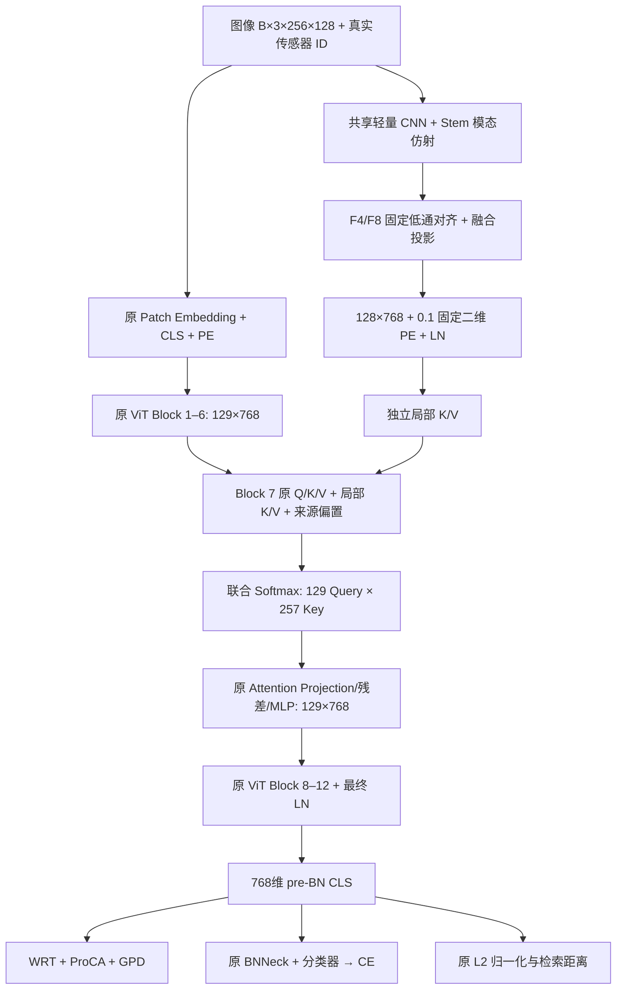

# UAD + SFTC-V2.1 实现、设计核对与实验说明

本次按根目录 `idea.md` 实现 SFTC-V2.1：一个轻量 CNN 局部信息来源，在第 7 个 ViT Block 扩展 Key/Value 候选，使用原 UAD 身份监督形成统一检索特征。原 `idea.md`、`configs/UAD.yml` 和四个参考项目均未改写。

## 1. 论文优先的设计核对

已阅读方案全文、五篇本地论文的正文、方法公式、实验与消融，核对关键结构图和参考项目的模型实现。定位如下（页码为 PDF 页码）：

| 依据 | 论文位置与原始机制 | 本次采用的思想与区别 |
|---|---|---|
| [WHU-MARS / UAD](../../WHU.pdf) | §4.2–4.5，p5–6；§3.3、§5；单模型、PKM、ProCA、GPD | 直接保留主干与损失契约、采样顺序、原型更新、同相机 Gallery 排除及原评测 |
| [FusionReID](../../FusionReID.pdf) | §III，p3–5，Fig.2–3；DFE、LRU、共享 SEU、双向 MFU、堆叠 HTM，六组特征监督/拼接检索 | 借鉴异构编码与跨来源注意力；不复制双大型主干、多个身份头或六特征拼接 |
| [ViT-CoMer](../../ViT-CoMer.pdf) | §3.1–3.3，p3–5，Fig.3–5；三尺度 CNN、分组多核 DWConv MRFP、可变形注意力 CTI、双向多阶段交互 | 借鉴主干内部 CNN/ViT 交互；不复制 MRFP/CTI，不引入可变形注意力依赖 |
| [MSCMNet](../../MSCMNet.pdf) | §III.B–D，p4–6，Fig.2(b)；四流 QFE、MIMB/ALB、浅深相关性与 QCT | 借鉴浅层信息利用的动机；不移植四流、ALB 原公式或 QCT |
| [SDS-Net](../../SDS-Net.pdf) | §III，p4–7，Fig.3/5/6；浅深异构分支、MSCA/MSSA、MDFA、ADSF、检测深监督 | 借鉴空间层级协同；不引入检测头、检测损失或额外融合门控 |

代码核对位置：`FusionReID/modeling/{make_model.py,fusion_part/fusion.py}`，`MSCMNet/model.py`，`SDS-Net/model/SDSNet.py`，`ViT-CoMer/detection/mmdet_custom/models/backbones/{comer_modules.py,vit_comer.py}`。

论文与开源代码不能视作完全一致。例如 MSCMNet ALB 论文用浅层 Q/K、浅深混合 V；代码还包含残差和空间维度归一化等具体处理。SDS-Net 论文描述 MDFA，而当前代码浅/深分支实际构造 `CBAMLayer`；ADSF 公式与代码也存在表示细节差异。本次不从这些差异中拼凑新模块，依照方案实现 SFTC 自身的明确定义。

SFTC 的 16×8 Token、单次局部 K/V、联合 Softmax、三模态/逐 Head 偏置以及五 Epoch 固定策略均为任务适配设计，不能称为原论文模块的直接复现。CNN 的不同归纳偏置、有效梯度或较高来源概率均不能证明检索增益。

## 2. 修改前审查后的补全决定

主体机制不增加额外门控、局部监督或训练阶段。重点补全以下实现边界：

1. **真实传感器映射。** WHU 训练图像按 `DATASETS.MODALITIES` 顺序整批拼接，评测数据编号从 1 开始。根据名称将 RGB、IR/NIR、Thermal/TIR 分别映射到稳定的参数行 0、1、2；训练标签长度由每个实际输入 chunk 生成。评测 `mode` 保持原作用，不用来猜传感器。名称未知、重复传感器或错误编号报错。
2. **DDP 安全的偏置固定。** 参数从构造时注册且一直 `requires_grad=True`。固定期前向使用 `source_bias*0 + (-2)`，保留零梯度计算图；反向和 AMP unscale 后再清零梯度、清除该参数陈旧优化器状态。偏置无 Weight Decay，第 6 个 Epoch 恢复使用真实参数。始终不替换参数对象，也不重建优化器/DDP。
3. **预训练与 checkpoint 分开。** 先构造并初始化原主干、加载 ImageNet、核验全部非 ImageNet 分类头的主干键，再构造新增分支并复制 Block 7 的 K/V。加载训练好的 SFTC checkpoint 时直接恢复其局部 K/V，不再次复制。正式 SFTC 评测拒绝缺失 CNN/KV/偏置的 UAD-only checkpoint。
4. **诊断的证据范围。** 来源概率在 Attention Dropout 前记录，区分 CLS 与 Patch，按传感器/Head 展示。CNN/KV 更新量直接比较 optimizer step 前后参数；裁剪频率覆盖 Rank 0 的全部训练 Step，分支梯度和更新量稀疏记录。验证对各模态第一批前 8 张图像比较来源开关 CLS，保存每个 Rank 独立 JSONL，避免原非主 Rank 空日志使结果丢失。
5. **固定结构约束。** 冻结版本要求 ViT-B/16、256×128、stride16、Block index6、768维、16×8、32/64/128 通道，以及 pre-BN 检索。错误配置提前报错。默认 SFTC 关闭，普通 UAD 的配置与接口继续可用。

DDP 参数必须在包装前完成注册，依据 [PyTorch 官方 DDP 文档](https://docs.pytorch.org/docs/stable/generated/torch.nn.parallel.DistributedDataParallel.html)。来源概率记录只使用 detached 张量，不增加额外梯度同步或分布式 collective。

## 3. 实际网络结构



| CNN 阶段 | 运算 | 输出 |
|---|---|---|
| Stem | 3×3 Conv 3→32, s2, p1；GN(8, affine=False)；传感器 γ/β；GELU | B×32×128×64 |
| Stage1 | DW3×3 s2 p1；GN8；GELU；PW32→64；GN8；GELU | F4: B×64×64×32 |
| Stage2 | DW3×3 s2 p1；GN8；GELU；PW64→128；GN16；GELU | F8: B×128×32×16 |
| 对齐 | F4 两次、F8 一次固定通道低通滤波+stride2 | 各16×8 |
| 融合 | Concat192；PW192→256；GN32；GELU | B×256×16×8 |
| 投影 | PW256→768；行优先 Flatten；固定PE×0.1；LN | B×128×768 |

所有新增 Conv 无 bias；DW groups 等于输入通道数；没有新增 BatchNorm2d。低通核为 `[[1,2,1],[2,4,2],[1,2,1]]/16`，reflect padding1。位置编码按 y/x 两个方向各384维，每轴 sin/cos 各192维，频率为 `1/10000^(i/192)`。局部 LN/GN 使用 PyTorch 默认 eps1e-5；原 ViT norm1/norm2/final LN 保持原 eps1e-6。

卷积 Kaiming normal fan-in 初始化；最终 Conv256→768 使用 std0.02 截断正态；GN/LN γ=1、β=0；Stem 模态 γ=1、β=0。局部 K/V 独立 Linear768→768，复制预训练 QKV 的 K/V 切片及 bias，之后独立训练。来源偏置 `b∈R^(3×12)` 初值−2。

第7层保持原 `blocks.6.attn.qkv`、`proj`、`scale`、两个 dropout、norm、DropPath、MLP 和残差顺序。仅扩展注意力候选：

\[
S_D = QK_D^T/\sqrt{64},\quad S_L = QK_L^T/\sqrt{64}+b_{m,h},
\quad P=\mathrm{softmax}([S_D,S_L]),\quad A=P[V_D;V_L].
\]

当所有内容 logits 为零时，局部来源概率为 `128 exp(-2)/(129+128 exp(-2))≈0.118388`。它是初始化先验示例，不是固定比例；Q/K 学习会改变真实份额。局部 Token 不进入后续 Block，不增加第二 CLS 或独立检索向量。

## 4. 损失、优化与原协议

\[
L=L_{CE}+L_{WRT}+0.01L_{ProCA}+L_{GPD}.
\]

CE 使用 BNNeck 后分类 logits；其余三项使用最终 pre-BN CLS。ProCA 继续逐模态聚合归一化特征、形成 stop-gradient 身份中心；GPD τ=0.03，全部身份原型判别，更新仍为旧原型0.8+新中心0.2后归一化。`processor.py` 中 PCA、PrototypeBank、GPD 的 AST 与修改前完全一致。

原 SGD momentum0.9、120 Epoch、五 Epoch warm-up + cosine 保留。原 ViT 的 LR、bias LR 和 Weight Decay 规则不变。新增参数 base LR×3（单卡配置0.024）；新增 Conv/Linear weight decay1e-4，新增 Linear bias、GN/LN、模态仿射与来源偏置不衰减；新增 bias 不再乘原2倍 bias因子。

调度器未改写，warm-up 初始 LR 与 cosine 最小 LR 均为原统一数值，因此实际 LR 比例不是始终精确3倍。合成检查中 Epoch1 原QKV weight LR0.001664、新KV0.004864；Epoch6 分别约0.00795085/0.02385236。

操作顺序：原损失 → AMP backward → unscale → 固定期偏置梯度处理 → 分支梯度快照（稀疏）→ 全模型 clip norm1.0 → 原 optimizer step/scaler update → 原 GPD 更新。没有分支独立裁剪。

`train.py`、`test.py`、数据增强、单卡 PKM、DDP PKM、采样 batch、Query/Gallery、相机过滤、metrics、原 loss 文件、原 UAD.yml 均未修改。正式训练和推理均启用同一 SFTC 路径，输出768维 pre-BN CLS。诊断关闭只对同一 SFTC 权重移除局部来源，不能等同独立训练 UAD。

原 checkpoint 是模型 state_dict；本次保留原保存方式与训练入口，没有增加训练断点续训机制。`load_param`/`load_param_finetune` 支持完整 SFTC 模型权重恢复，但完整 optimizer/scheduler/scaler/epoch/原型库续训仍需另行实现，不能称作已有功能。

## 5. 文件变更清单

| 文件（相对 WHU） | 操作 | 新增/调整功能及目的 |
|---|---|---|
| `model/backbones/sftc_local.py` | 新增 | 模态映射与配置核验；CNN；低通；二维PE；KV复制；来源偏置固定/释放；来源概率统计 |
| `model/backbones/vit_pytorch.py` | 修改 | Attention/Block 可选局部候选；仅Block7接入；诊断关闭；预训练主干键完整性报告与严格核验 |
| `model/make_model.py` | 修改 | 构造/加载/初始化接线；训练/评测真实模态；保持原返回值；完整SFTC checkpoint核验 |
| `processor/processor.py` | 修改 | 真实模态传参；偏置 Epoch管理；unscale后处理；裁剪/更新日志；每Rank CLS诊断；正式/关闭推理开关 |
| `solver/make_optimizer.py` | 修改 | 新增参数3倍LR，正确零衰减；原参数规则保留 |
| `config/defaults.py` | 修改 | 默认关闭SFTC；新增结构/优化/诊断配置；clip默认1.0 |
| `configs/UAD_SFTC_V2_1.yml` | 新增 | 独立冻结实验配置；原UAD配置保持原样 |
| `utils/sftc_diagnostics.py` | 新增 | detached来源统计的持久化、真实参数更新范数、CLS开关差异记录 |
| `tests/check_sftc.py` | 新增 | 无数据集自检：结构、梯度、冻结、加载、概率、映射及可选两进程DDP |
| `tools/profile_sftc.py` | 新增 | 不依赖预训练/数据集的CPU/CUDA参数、MACs、推理耗时及CUDA峰值显存统计 |
| `docs/SFTC_V2_1.md` | 新增 | 本文：设计核对、实现说明、命令、验证边界和实验判定 |
| `docs/sftc_validation.json` | 新增 | 当前机器的检查结果、成本统计及未验证事项 |

没有删除已有文件或已有模型功能。默认关闭时没有新增模型参数。保留原 ImageNet `base.fc` 未参与 ReID 损失的事实，因此沿用原 DDP `find_unused_parameters=True`。

## 6. 已执行自检与成本

详细结果见 [sftc_validation.json](sftc_validation.json)。本机为 Windows、PyTorch2.8.0+cpu，未安装目标CUDA训练环境，未提供WHU数据集或ImageNet/UAD训练权重；当前 `WHU/` 中未发现训练日志或`.pth/.pt`权重文件。不能核验历史WQVD/TAUR或UAD实际日志结果。

已通过的检查：Python语法编译；完整12层ViT合成前向/四项损失反向；CNN、KV、ViT有限非零梯度及真实新增参数更新；真实chunk和重排模态映射；张量尺寸；联合Softmax先验及Dropout前统计；二维PE行优先展开；全部参数进入optimizer与LR/decay；Epoch1/5偏置精确−2、Epoch6释放；陈旧momentum清理；合成ImageNet格式全部152键加载、197→129位置插值、缺失QKV报错；完整SFTC恢复、不重抄KV、缺失新分支报错；eval来源关闭与本地修改前ViT逐值完全相等。还检查了CPU BF16 autocast的局部源与ViT Block前后向；它不能替代CUDA FP16/GradScaler验证。

两进程 CPU/Gloo 检查在本机 `init_process_group` 阶段因 `makeDeviceForHostname(): unsupported gloo device` 失败，模型尚未构造；切换UV transport亦未解决。因此没有宣称DDP运行通过，已保留可在支持Gloo的服务器执行的检测脚本。正式NCCL、CUDA AMP、真实数据loader及完整训练需要目标服务器验证。

| 统计，500训练身份，256×128 | 原UAD | UAD+SFTC |
|---|---:|---:|
| 实际保留总参数 | 86,900,968 | 88,342,732 |
| 新增参数 | — | 1,441,764 |
| 新CNN编码器（含仿射与norm） | — | 260,544 |
| 新独立K/V（含bias） | — | 1,181,184 |
| 新来源偏置 | — | 36 |
| 单图MACs | 11,338,795,008 | 11,563,476,992 |
| 同口径FLOPs（MAC×2） | 22,677,590,016 | 23,126,953,984 |

MACs增量224,681,984，约1.98%。统计包含Conv/Linear、QK/AV矩阵乘与固定滤波，不含norm、激活、softmax与逐元素运算；不能与不同统计口径直接比较。总参数保留原未使用`base.fc`的769,000参数以及原外分类器/BNNeck，因此与论文表格的85.7M口径不同。

单批1张、CPU4线程、3次warm-up/10次测量，在本次记录中UAD约219.55ms/图、SFTC约204.40ms/图。CPU短测受缓存与调度噪声影响，不能据此声称SFTC更快。显存与GPU推理耗时没有实测值；附profiling工具用于服务器实际测量。训练显存需在真实PKM batch和optimizer/AMP下测量，推理峰值显存不能代替它。

## 7. 运行方式

以下命令在 `WHU/` 下运行，先指定服务器真实数据根目录和ImageNet权重路径。使用服务器已有UAD环境；本次没有改写requirements或安装训练依赖。

```bash
# 单卡：基础batch64 -> 每模态64 -> 实际192张图像
CUDA_VISIBLE_DEVICES=0 python train.py \
  --config_file configs/UAD_SFTC_V2_1.yml \
  MODEL.DIST_TRAIN False \
  DATASETS.ROOT_DIR /path/to/data \
  MODEL.PRETRAIN_PATH /path/to/jx_vit_base_p16_224-80ecf9dd.pth \
  OUTPUT_DIR logs/UAD_SFTC_V2_1_1000_single

# 沿用仓库原README的4卡规模；baseline比较也必须使用相同覆盖项
# 全局基础batch256 -> 每rank基础64 -> 每rank实际192张
CUDA_VISIBLE_DEVICES=0,1,2,3 torchrun --standalone --nproc_per_node=4 \
  train.py --config_file configs/UAD_SFTC_V2_1.yml \
  MODEL.DIST_TRAIN True SOLVER.IMS_PER_BATCH 256 SOLVER.BASE_LR 0.032 \
  DATASETS.ROOT_DIR /path/to/data \
  MODEL.PRETRAIN_PATH /path/to/jx_vit_base_p16_224-80ecf9dd.pth \
  OUTPUT_DIR logs/UAD_SFTC_V2_1_1000_DDP

# 正式完整SFTC checkpoint评测，无需再次加载ImageNet文件
CUDA_VISIBLE_DEVICES=0 python test.py \
  --config_file configs/UAD_SFTC_V2_1.yml \
  MODEL.PRETRAIN_CHOICE self MODEL.DIST_TRAIN False \
  DATASETS.ROOT_DIR /path/to/data \
  TEST.WEIGHT logs/UAD_SFTC_V2_1_1000_DDP/transformer_120.pth \
  TEST.DETAILED_DOMAIN_EVAL True \
  OUTPUT_DIR logs/UAD_SFTC_V2_1_1000_DDP_eval
```

DDP示例的baseLR0.032来自当前仓库原README，新增峰值LR因此为0.096。不能将单卡0.024的新参数LR与这套4卡配置混为一谈；比较baseline时GPU数、基础batch、baseLR、seed、steps、每rank实际样本和评测必须匹配。论文描述、历史结果、当前README运行配置是不同来源，不能随意合并成一个已核验结果。

完整关闭来源诊断可在正式test命令额外覆盖 `SFTC.TEST_LOCAL_ENABLED False`，并改用单独OUTPUT_DIR。它保持SFTC结构/checkpoint，仅在eval跳过CNN/KV，输出当前共享主干的CLS，不构造独立UAD结果。

```bash
# 合成工程检查（不需要数据集、ImageNet文件或GPU）
python tests/check_sftc.py --report sftc_check.json

# 有Gloo支持时，单独检查两进程冻结/释放和参数同步
python tests/check_sftc.py --ddp-only --report sftc_ddp_check.json

# 服务器推理成本；此工具使用随机权重，不评测检索精度
python tools/profile_sftc.py --device cuda:0 --batch-size 32 --amp \
  --warmup 10 --iterations 50 --report sftc_profile_gpu.json
```

训练产物：原训练日志与`transformer_120.pth`；新增`sftc_diagnostics.jsonl`（Rank0实际LR、来源偏置、按模态/Head的CLS与Patch概率、CNN/KV裁剪前梯度/实际更新、AMP是否跳步、每Epoch裁剪频率）；每Rank的`sftc_cls_diagnostics_rankN.jsonl`（验证小样本的最终CLS开关差异）。这些是机制证据，不是正式检索结果。

## 8. 正式实验判定

首轮按原方案完成独立UAD vs SFTC120 Epoch比较。报告整体AS-ReID的mAP/R1/R5/R10、九组模态对及Ground↔Aerial，必要时用原36个域协议分析。保持完整Gallery、相机过滤、pre-BN/L2，不开re-ranking/TTA。

当前没有训练完成的SFTC模型、精度结果、真实身份信息增益或GPU显存结论。合成数据的损失/CLS变化仅排除工程错误，不能预测WHU性能。原metrics没有逐Query AP导出功能，本次按不改评测文件的约束保留原样；若后续需要方案提到的完整Gallery逐Query迁移分析，应对保存的特征另做离线分析，不能将域协议表当作逐Query结果。

模型侧已测试重排文件夹后的传感器映射；正式实验仍保持原配置 `['RGB','IR','Thermal']`。原metrics中协议名称按该顺序解释数字模态ID，本次没有改写它，不能把模型支持重排理解为所有原评测表也支持重排后的名称解释。
